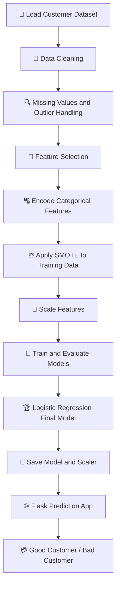

<div align="center">

# 💳 Credit Risk Analytics
### Customer Classification Using Machine Learning 🤖

**Turning customer data into meaningful credit risk insights.**

<p>
  
  
  
  
</p>

📊 **Data Processing** &nbsp; • &nbsp; 🧠 **Model Building** &nbsp; • &nbsp; 🌐 **Web Prediction App**

</div>

---

## 🌟 About the Project

This project uses **machine learning to classify credit customers** based on selected financial and demographic information. It demonstrates how a structured data science workflow can be used to support credit risk analysis.

The project covers data preprocessing, feature selection, class imbalance handling, model comparison, and deployment of a trained Logistic Regression model through a simple Flask web application.

> 🎯 **Project goal:** Build a machine learning workflow that classifies customers as **Good Customer** or **Bad Customer** based on the model's prediction.

⚠️ This is an educational project. Predictions should not be used as the sole basis for real credit decisions.

## ✨ Key Features

| Feature | What it does |
|---|---|
| 🧹 Data preprocessing | Handles selected missing values, data types, and outliers |
| 🎯 Feature selection | Uses variance thresholds and Pearson correlation hypothesis testing |
| 🔠 Categorical encoding | Applies One-Hot Encoding and Ordinal Encoding |
| ⚖️ Class balancing | Uses SMOTE on the training data |
| 🧠 Model comparison | Includes several classification algorithms |
| 📈 Model evaluation | Uses confusion matrices, accuracy, precision, recall, F1-score, and ROC curves |
| 🌐 Web application | Accepts customer inputs and displays a prediction using Flask |
| 💾 Model persistence | Saves the trained model and scaler using Pickle |

## 🛠️ Tech Stack

- 🐍 **Python** — core programming language
- 🧮 **Pandas & NumPy** — data manipulation
- 🤖 **Scikit-learn** — preprocessing, feature selection, classification, and evaluation
- ⚖️ **Imbalanced-learn** — SMOTE
- 🚀 **XGBoost** — gradient-boosting classifier
- 📊 **Matplotlib & Seaborn** — visualisation
- 🧪 **SciPy** — statistical functions
- 🌐 **Flask** — web application
- 🎨 **HTML & CSS** — prediction form and interface
- 📦 **Pickle** — saving and loading the model and scaler

## 🔄 Project Workflow



## 🧠 Machine Learning Models

The model module includes implementations for:

- K-Nearest Neighbors (KNN)
- Gaussian Naive Bayes
- Logistic Regression
- Decision Tree
- Random Forest
- AdaBoost
- Gradient Boosting
- XGBoost
- Support Vector Machine (SVM) — implemented in the module but not included in the active comparison workflow

The main pipeline trains **Logistic Regression** as the final model.

📌 **Evaluation matters:** Accuracy alone may not be enough for credit risk classification. Precision, recall, F1-score, and the confusion matrix help explain how the model handles each customer class.

*Model performance metrics should be added here after running the pipeline successfully. No performance values are claimed in this README.*

## 📁 Repository Structure

```text
credit-risk-customer-classification/
│
├── all_models.py              # Classification model implementations
├── app.py                     # Flask web application
├── creditcard.csv             # Input dataset (check licence before sharing)
├── credit_card.pkl            # Saved Logistic Regression model
├── standard_scaler.pkl        # Saved feature scaler (generated during training)
├── fs.py                      # Numerical feature selection
├── log_code.py                # Logging configuration
├── main.py                    # Main machine learning pipeline
├── missing_data_handling.py   # Missing-value handling module
├── vt_outlier.py              # Outlier-handling module
├── requirements.txt           # Python dependencies
├── README.md                  # Project documentation
│
└── templates/
    └── index.html             # Flask HTML prediction page
```

> 📝 Ensure that `missing_data_handling.py`, `vt_outlier.py`, and `standard_scaler.pkl` are present when required. The scaler is generated by a successful training run. Place `index.html` inside `templates/` so Flask can find it. Adjust the structure above if your repository differs.

## 🚀 Getting Started

Follow these steps to run the project locally.

### 1️⃣ Clone the repository

```bash
git clone https://github.com/YOUR-USERNAME/credit-risk-customer-classification.git
cd credit-risk-customer-classification
```

Replace `YOUR-USERNAME` with your GitHub username.

### 2️⃣ Create and activate a virtual environment

**Windows**
```bash
python -m venv venv
venv\Scripts\activate
```

**macOS / Linux**
```bash
python3 -m venv venv
source venv/bin/activate
```

### 3️⃣ Install dependencies

Create a `requirements.txt` file containing the packages used by the project:

```text
pandas
numpy
scikit-learn
imbalanced-learn
matplotlib
seaborn
scipy
xgboost
flask
```

Then install them:

```bash
pip install -r requirements.txt
```

💡 For reproducible results, test the project with compatible package versions and pin those versions in `requirements.txt`.

### 4️⃣ Train the model

Make sure the dataset and all required Python modules are in place, then run:

```bash
python main.py
```

The pipeline prepares the data, performs feature engineering, balances the training set, trains Logistic Regression, evaluates predictions, and saves the model and scaler.

### 5️⃣ Start the web app

After both `credit_card.pkl` and `standard_scaler.pkl` have been generated and are available:

```bash
python app.py
```

Open the local URL shown in the terminal, usually:

**http://127.0.0.1:5000/**

Enter the required customer information and submit the form to see the predicted class.

## 📊 Evaluation Metrics

| Metric | Why it matters |
|---|---|
| 🎯 Accuracy | Overall proportion of correct predictions |
| 🔎 Precision | How often predictions for a class are correct |
| 📢 Recall | How many actual cases of a class are identified |
| ⚖️ F1-score | Balance between precision and recall |
| 🧩 Confusion matrix | Shows correct and incorrect predictions for each class |
| 📈 ROC curve | Visualises discrimination across classification thresholds |

For credit risk, review the metrics for the **bad-customer class** carefully, including false negatives and false positives. Model quality should be validated before any real-world use.

## 💡 What I Learned

- Building a modular machine learning pipeline in Python
- Preparing numerical and categorical data for classification
- Applying feature selection and statistical testing
- Understanding class imbalance and using SMOTE
- Comparing classification models with multiple evaluation metrics
- Saving and reusing trained models and preprocessing objects
- Connecting a machine learning model to a Flask web interface

## 🔮 Future Improvements

- 📊 Add exploratory data analysis and clearer visualisations
- 🧪 Tune hyperparameters and use cross-validation
- ⚖️ Assess fairness and performance across customer groups
- 🎚️ Explore classification thresholds and precision-recall trade-offs
- 🧰 Package preprocessing and prediction into one consistent pipeline
- 🚀 Deploy the application and add automated tests
- 📝 Document actual model results and limitations

## 🔐 Responsible Use

This project is for **learning and portfolio demonstration only**. Credit-related models can affect people's access to financial services. A real deployment would require careful validation, privacy protections, fairness testing, explainability, security review, and compliance with applicable laws and regulations.

Only share datasets you are permitted to redistribute. Do not load Pickle files from untrusted sources, as they can execute code.

## 👨‍💻 Author

**YOUR NAME**

📌 *Finance, analytics, and machine learning enthusiast*

- GitHub: [@YOUR-USERNAME](https://github.com/YOUR-USERNAME)

---

<div align="center">

⭐ If you find this project useful, consider giving the repository a star!

**Built with Python, machine learning, and curiosity. 💙**

</div>
